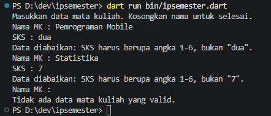
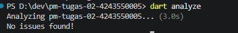

# Tugas Rutin 3 - Kalkulator IP Semester (Console)

**Nama:** (namamu)
**NIM:** 4243550005
**Mata kuliah:** Pemrograman Mobile (3KOM40215)

## Cara menjalankan
dart run bin/ip_semester.dart

## Tangkapan layar

## Penjelasan
program ini adlah kalkulator IP semester berbasis console. pengguna memasukkan nama mata kuliah , sks, dan juga huruf satu persatu sampai nama dikosong kan, lalu programnya mencetak KHS berisi daftar nama matakuliah, total sks nya dan juga nilai matakuliah nya, dan akan menampilkan pesan "mata kuliah yang perlu diperbaiki" jika IP tidak memenuuhi syarat.

Higher-order function saya pakai di dua fungsi. Di `hitungIp`, `fold`
menerima fungsi anonim untuk menjumlahkan SKS dan hasil kali SKS dengan
bobot, lalu hasilnya dibagi total SKS. Di `cetakKhs`, `sort` menerima
fungsi pembanding bobot nilai agar KHS terurut dari nilai tertinggi,
sedangkan `where` menyaring mata kuliah berbobot di bawah 2.

untuk error handling, `validasiSks` dan `validasiNilai` melempar
`FormatException` bila SKS bukan angka 1-6 atau nilai bukan A-E.
exception ditangkap di satu tempat, yaitu `try` dan `on FormatException`
di `main`, sehingga data yang salah hanya diabaikan dan program tetap
lanjut. data yang diabaikan tidak ikut dihitung dalam IP.

## Hasil dart analyze

## Pernyataan penggunaan AI

saya memakai claude (ai buatan anthropic) untuk membantu menyusun
kerangka kalkulator ip ini, mulai dari pembagian fungsinya (validasi,
bobot, hitung ip, predikat, dan cetak khs) sampai contoh pemakaian
fold, where, dan sort. setelah itu saya menjalankan programnya
sendiri dengan data yang benar dan data yang salah, seperti sks "tiga",
lalu mempelajari cara kerja tiap fungsinya. penjelasan di atas saya
sesuaikan dengan kode yang saya jalankann.